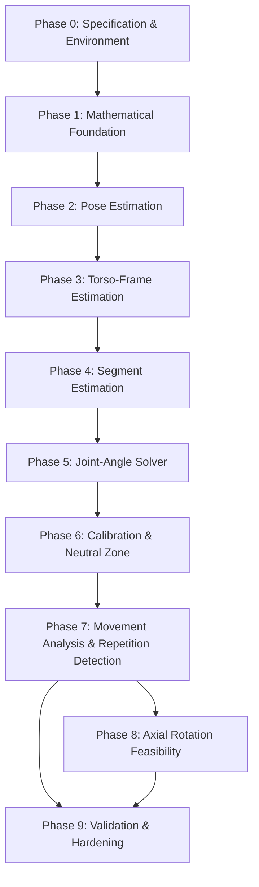

# PHASES.md — Implementation Roadmap and Milestone Tracking
## AURI: Computer Vision & Biomedical Engine

---

## Roadmap Overview

---

## Phase Status Summary

| Phase | Title | Status | Dependencies | Target Requirements |
|---|---|---|---|---|
| **Phase 0** | Specification, Environment & Mathematical Architecture | **COMPLETE** | None | `SYS-REQ-001`, `PRIV-REQ-001` |
| **Phase 1** | Mathematical Foundations & Vector Geometry | **COMPLETE** | Phase 0 | `BIO-REQ-001`, `BIO-REQ-002`, `BIO-REQ-003` |
| **Phase 2** | Pose Ingestion, Normalization & Quality Gate | **COMPLETE** | Phase 0 | `CV-REQ-001` to `CV-REQ-005`, `QUAL-REQ-001` |
| **Phase 3** | Torso Coordinate Frame Estimation | **COMPLETE** | Phase 1, Phase 2 | `BIO-REQ-004`, `BIO-REQ-005`, `BIO-REQ-006` |
| **Phase 4** | Anatomical Segment Estimation | **COMPLETE** | Phase 1, Phase 3 | `BIO-REQ-007` |
| **Phase 5** | Joint-Angle Kinematics Solver (Flexion, Abduction) | **COMPLETE** | Phase 3, Phase 4 | `BIO-REQ-007`, `BIO-REQ-008` |
| **Phase 6** | Baseline Calibration & Neutral Zone Zeroing | **COMPLETE** (CAL-REQ-006 partial) | Phase 5 | `CAL-REQ-001` to `CAL-REQ-006`, `QUAL-REQ-002` |
| **Phase 7** | Movement Protocols, Repetition FSM & Compensation | **COMPLETE** | Phase 6 | `REP-REQ-001` to `REP-REQ-004`, `COMP-REQ-001` to `COMP-REQ-004` |
| **Phase 8** | Humeral Axial Rotation Feasibility Assessment | `IN_PROGRESS` (protocol-gated estimator + analysis in docs/MOVEMENT_ANALYSIS.md; no empirical study) | Phase 5, Phase 7 | Movement Protocol Feasibility Study |
| **Phase 9** | Validation, Hardening & Regression Suite | `NOT_STARTED` | Phases 1–8 | All Requirements / Validation Plan |

---

## Detailed Phase Specifications

### Phase 0: Specification, Environment & Mathematical Architecture
- **Objective**: Establish the Python 3.12 environment, verify installed MediaPipe 1.x Tasks API, generate mandatory project documentation, establish coordinate frame conventions, formulate the initial mathematical model with equations and assumptions, and define initial synthetic test cases.
- **Deliverables**:
  - `AGENTS.md`, `PRD.md`, `TECH_STACK.md`, `PHASES.md`, `PROJECT_LOG.md`
  - `docs/ARCHITECTURE.md`, `docs/MATHEMATICAL_MODEL.md`, `docs/BIOMECHANICAL_CONVENTIONS.md`
  - `docs/VALIDATION_PLAN.md`, `docs/KNOWN_LIMITATIONS.md`, `docs/DECISIONS.md`
  - `pyproject.toml`, `requirements.txt`, `.gitignore`, `README.md`
  - Directory structure and initial synthetic test suite skeleton (`tests/synthetic/`)
- **Exit Criteria**:
  - Python 3.12 venv created and dependencies verified.
  - All mandatory documents created and cross-referenced.
  - Initial synthetic test cases defined.
  - Review presented with explicit open decisions.
- **Status**: `COMPLETE` (Verified on 2026-10-28)

---

### Phase 1: Mathematical Foundations & Vector Geometry
- **Objective**: Implement core 3D vector, matrix, and transformation primitives with strict numerical safeguards.
- **Deliverables**:
  - `src/auri_cv/geometry/vectors.py` (dot, cross, norm, unit, safe division, cosine clamping)
  - `src/auri_cv/geometry/rotations.py` (orthonormality assertion, determinant validation, axis-angle, SO(3) checks)
  - `src/auri_cv/geometry/angles.py` (unsigned vector angle, signed angle around projection axis)
  - `tests/unit/test_vectors.py`, `tests/synthetic/test_angles.py`
- **Exit Criteria**:
  - 100% test pass on known geometric angles (0°, 30°, 45°, 90°, 180°).
  - Explicit error handling for collinear, anti-parallel, zero-length, and non-finite vectors.
- **Status**: `COMPLETE` (Verified on 2026-10-28; 82 passing tests)

---

### Phase 2: Pose Ingestion, Normalization & Quality Gate
- **Objective**: Integrate MediaPipe Tasks Vision `PoseLandmarker`, standardize 2D and 3D landmark structures, and implement early quality gates.
- **Deliverables**:
  - `src/auri_cv/pose/landmarker.py`, `src/auri_cv/pose/data_models.py`
  - `src/auri_cv/quality/landmark_quality.py` (visibility, presence, occlusion checks)
  - `tests/unit/test_pose_models.py`, `tests/synthetic/test_quality_gates.py`
- **Exit Criteria**:
  - Pose results parse into typed immutable data models.
  - Missing landmarks or low confidence scores ($V < 0.5$) trigger explicit quality degradation.
- **Status**: `COMPLETE` (Verified on 2026-10-28; 102 passing tests)

---

### Phase 3: Torso Coordinate Frame Estimation
- **Objective**: Construct the subject-centered orthonormal Torso Frame ($T$) from shoulder and hip landmarks, rejecting degenerate geometries.
- **Deliverables**:
  - `src/auri_cv/frames/torso_frame.py` (superior axis, lateral orthogonalization, anterior cross-product, transformation matrices $R_{W \leftarrow T}$, $R_{T \leftarrow W}$)
  - `tests/synthetic/test_torso_frame.py` (round-trip point and vector transformations, synthetic torso lean and rotation)
- **Exit Criteria**:
  - Synthetic torso frames produce exact orthonormal matrices ($R^T R = I, \det(R) = 1$).
  - Degenerate frames (collinear or zero-area torso) raise explicit `DegenerateGeometryError`.
- **Status**: `COMPLETE` (Verified on 2026-10-28; 132 passing tests)

---

### Phase 4: Anatomical Segment Estimation
- **Objective**: Compute upper-arm and forearm segment direction vectors and project them into the Torso Frame.
- **Deliverables**:
  - `src/auri_cv/anatomy/segments.py` (shoulder-to-elbow arm vector, elbow-to-wrist forearm vector)
  - Type-safe enforcement that direction vectors are NOT full SO(3) orientations.
  - `tests/synthetic/test_segments.py`
- **Exit Criteria**:
  - Direction vectors properly normalized and transformed into Torso Frame.
  - Segment interfaces strictly prevent invalid axial rotation assumptions.
- **Status**: `COMPLETE` (Verified on 2026-10-28; 144 passing tests)

---

### Phase 5: Joint-Angle Kinematics Solver (Flexion, Abduction)
- **Objective**: Calculate humerothoracic elevation, forward flexion, and abduction angles in the Torso Frame with sign conventions and plane projections.
- **Deliverables**:
  - `src/auri_cv/kinematics/elevation.py`, `src/auri_cv/kinematics/projections.py`
  - Explicit laterality handling (Left vs. Right shoulder).
  - `tests/synthetic/test_kinematics.py`
- **Exit Criteria**:
  - Elevation angle correctly solves to 0° at downward neutral, 90° horizontal, 180° full overhead.
  - Laterality symmetry verified (Right and Left arms behave symmetrically).
- **Status**: `COMPLETE` (Verified on 2026-10-29; 172 passing tests; adds `solver.py` / `RawKinematics`)

---

### Phase 6: Baseline Calibration & Neutral Zone Zeroing
- **Objective**: Implement multi-frame baseline calibration ($\theta_0$), relative excursion calculation ($\Delta\theta(t)$), and configurable display deadband with hysteresis ($\delta_{enter}, \delta_{exit}$).
- **Deliverables**:
  - `src/auri_cv/calibration/calibrator.py`, `src/auri_cv/calibration/neutral_zone.py`
  - Strict preservation of raw, filtered, relative, and display angles.
  - `tests/synthetic/test_neutral_zone.py`, `tests/synthetic/test_calibration.py`
- **Exit Criteria**:
  - Resting baseline displays rock-solid $0.0^\circ$.
  - Fluctuations inside deadband display $0.0^\circ$; genuine excursions cross exit threshold smoothly.
  - Tracking failure produces `UNAVAILABLE`, never a false $0.0^\circ$.
- **Status**: `COMPLETE` (Verified on 2026-10-29; 190 passing tests). `CAL-REQ-006` is partial: recalibration triggers on quality-gate status and tracking gaps; subject relocation / torso shift is not yet detected (see KNOWN_LIMITATIONS).

---

### Phase 7: Movement Protocols, Repetition FSM & Compensation
- **Objective**: Implement temporal smoothing, finite-state machine repetition counting, and compensation metrics (trunk lean, rotation, shoulder hiking).
- **Deliverables**:
  - `src/auri_cv/filtering/filters.py` (SMA, exponential smoothing)
  - `src/auri_cv/movements/repetition_fsm.py`
  - `src/auri_cv/movements/compensation.py`
  - `tests/synthetic/test_repetition_fsm.py`, `tests/synthetic/test_compensation.py`
- **Exit Criteria**:
  - State machine correctly increments rep count on valid kinematic profiles and resets on tracking failure.
  - Compensation warnings fire deterministically when trunk lean exceeds threshold.
- **Status**: `COMPLETE` (Verified on 2026-10-29; 217 passing tests). Lean/rotation are baseline-relative (see ADR-009); `COMP-REQ-002` is relative to baseline, not the camera axis.

---

### Phase 8: Humeral Axial Rotation Feasibility Assessment
- **Objective**: Conduct rigorous mathematical and visual feasibility evaluation for observing humeral internal/external rotation from monocular camera data vs. IMU necessity.
- **Deliverables**:
  - `docs/AXIAL_ROTATION_FEASIBILITY.md`
  - Protocol specification (e.g. 90° elbow flexion in frontal view) with observability matrix.
  - Documented interface contract for future Upper-Arm IMU sensor.
- **Exit Criteria**:
  - Defensible recommendation produced (supported under specific protocol OR designated IMU-dependent).
- **Status**: `NOT_STARTED`

---

### Phase 9: Validation, Hardening & Regression Suite
- **Objective**: Execute end-to-end regression tests across all synthetic benchmarks, evaluate jitter and noise sensitivity, document Bland-Altman validation protocol, and package reproducible benchmarks.
- **Deliverables**:
  - Full automated test suite execution report.
  - `scripts/benchmark_accuracy.py`
  - Final documentation update in `PROJECT_LOG.md` and `docs/KNOWN_LIMITATIONS.md`.
- **Exit Criteria**:
  - 100% test pass on full suite.
  - Zero unhandled exceptions on edge-case synthetic inputs.
- **Status**: `NOT_STARTED`
