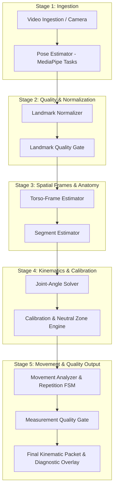
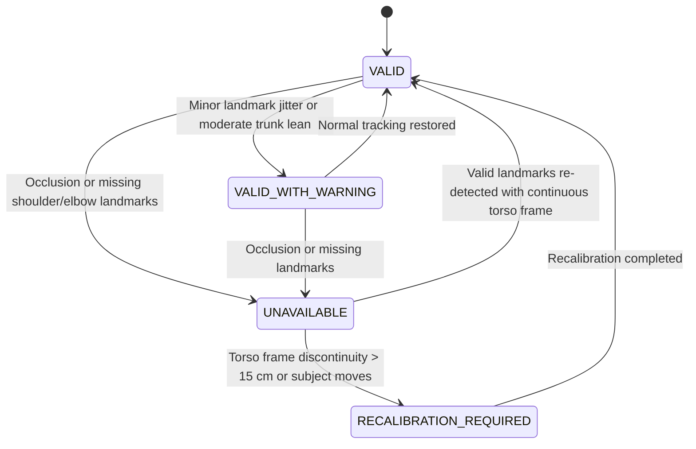

# System Architecture Document
## AURI: Computer Vision & Biomedical Engine

---

## 1. Architectural Philosophy and Design Principles

1. **Separation of Observation and Interpretation**:
   - The pose estimator is strictly an observation source that produces raw 2D and 3D coordinate observations.
   - The biomedical engine is a deterministic interpreter that applies geometric rules, coordinate transformations, anatomical constraints, calibration baselines, and quality gates.
2. **Strict Modular Decoupling**:
   - Mathematical calculations must never import or depend upon OpenCV, GUI libraries, camera drivers, or file systems.
   - Every stage consumes typed input contracts and emits typed output contracts.
3. **Fail-Fast and Explicit Quality States**:
   - The system never conceals tracking failures or degenerate geometry by substituting fallback constants (such as 0° or previous valid angles).
   - Degradation is surfaced immediately through an explicit quality status enum: `VALID`, `VALID_WITH_WARNING`, `UNAVAILABLE`, `RECALIBRATION_REQUIRED`.
4. **Data Layer Preservation**:
   - Raw observations, filtered estimates, relative excursions, and display angles exist as distinct, simultaneously accessible fields in observation packets.
5. **No Mobile or Cloud Coupling**:
   - The core engine is self-contained Python. All communication interfaces for future mobile shells (Flutter/Android) or sensor devices (IMUs) are defined as abstract data contracts.

---

## 2. End-to-End Pipeline Overview



---

## 3. Detailed Pipeline Stage Contracts

### Stage 1: Video Acquisition (`auri_cv.video`)
- **Responsibility**: Ingest frames from USB/integrated webcams or video files via OpenCV (`cv2.VideoCapture`).
- **Input**: Camera device index or video file path.
- **Output**: `RawVideoFrame(frame: np.ndarray, timestamp_ms: float, frame_index: int)`.
- **Failure Modes**: Camera disconnected, video file unreadable, frame drop.

### Stage 2: Pose Estimation (`auri_cv.pose`)
- **Responsibility**: Run MediaPipe Tasks Vision `PoseLandmarker` on each frame to extract 33 skeletal landmarks.
- **Input**: RGB `np.ndarray` and `timestamp_ms`.
- **Output**: `RawPoseObservation(landmarks_2d: List[Landmark2D], landmarks_3d: List[Landmark3D], presence: bool, timestamp_ms: float)`.
- **Failure Modes**: No human detected, multiple subjects detected (isolate primary subject based on bounding box area).

### Stage 3: Landmark Normalization & Landmark Quality Gate (`auri_cv.quality`)
- **Responsibility**: Validate landmark visibility, presence, and coordinate validity. Reject non-finite (NaN, Inf) or out-of-bounds coordinates.
- **Input**: `RawPoseObservation`.
- **Output**: `ValidatedPoseObservation(landmarks_3d: Dict[str, np.ndarray], quality_score: float, status: QualityStatus)`.
- **Failure Modes**: Key anatomical landmarks (left/right shoulders, hips, elbows) have visibility $< V_{min}$ ($0.5$). Emits `UNAVAILABLE`.

### Stage 4: Torso-Frame Estimator (`auri_cv.frames`)
- **Responsibility**: Establish a subject-centric orthonormal coordinate system ($T$) from shoulders ($S_L, S_R$) and hips ($H_L, H_R$).
- **Output**: `TorsoCoordinateFrame(origin: np.ndarray, R_W_to_T: np.ndarray, R_T_to_W: np.ndarray, is_valid: bool)`.
- **Failure Modes**: Distance between shoulders or hips $< \epsilon$ ($10^{-4}\,\text{m}$), collinear trunk landmarks, ill-conditioned matrix determinant ($|\det(R) - 1.0| > 10^{-4}$). Emits `DegenerateGeometryError`.

### Stage 5: Segment Estimator (`auri_cv.anatomy`)
- **Responsibility**: Construct upper-arm direction vector $\hat{\mathbf{v}}_{\text{arm}}$ (shoulder to elbow) and forearm direction vector $\hat{\mathbf{v}}_{\text{forearm}}$ (elbow to wrist), transformed into Torso Frame $T$.
- **Output**: `SegmentState(upper_arm_dir_T: np.ndarray, forearm_dir_T: np.ndarray, arm_length_m: float)`.
- **Boundary Rule**: Segments are represented as unit direction vectors ($\mathbb{S}^2$), **never** as full 3D rotation matrices (SO(3)), preventing unobservable axial rotation assumptions.

### Stage 6: Joint-Angle Solver (`auri_cv.kinematics`)
- **Responsibility**: Compute humerothoracic elevation angle, forward flexion projection, and coronal abduction projection relative to Torso Frame axes.
- **Output**: `RawKinematics(elevation_deg: float, flexion_deg: float, abduction_deg: float, timestamp_ms: float)`.
- **Mathematical Safety**: Clamp all dot products to $[-1.0, 1.0]$ before evaluating $\arccos$ or $\operatorname{atan2}$.

### Stage 7: Calibration & Neutral Zone Engine (`auri_cv.calibration`)
- **Responsibility**: Establish resting baseline $\theta_0$ through multi-frame median filtering during patient calibration. Compute relative excursion $\Delta\theta(t) = \theta(t) - \theta_0$. Apply display deadband with hysteresis.
- **Output**: `CalibratedKinematics(raw_deg: float, filtered_deg: float, relative_excursion_deg: float, display_deg: float, is_in_neutral_zone: bool, is_calibrated: bool)`.
- **Failure Modes**: Patient movement during calibration baseline acquisition; abrupt posture shift invalidating baseline. Emits `RECALIBRATION_REQUIRED`.

### Stage 8: Movement Analyzer & Repetition FSM (`auri_cv.movements`)
- **Responsibility**: Track repetition progress via a deterministic Finite State Machine (`IDLE` $\rightarrow$ `RAISING` $\rightarrow$ `PEAK_HOLD` $\rightarrow$ `LOWERING` $\rightarrow$ `COMPLETE`). Evaluate compensation metrics (trunk lean, trunk rotation, shoulder hiking).
- **Output**: `MovementMetrics(repetition_count: int, current_phase: MovementPhase, peak_angle_deg: float, trunk_lean_deg: float, shoulder_hiking_m: float, compensations: List[CompensationWarning])`.

### Stage 9: Measurement Quality Gate (`auri_cv.quality`)
- **Responsibility**: Synthesize landmark visibility, frame condition number, temporal jitter, and compensation metrics into a final operational quality status.
- **Output**: `KinematicPacket(kinematics: CalibratedKinematics, movement: MovementMetrics, quality: QualityStatus, timestamp_ms: float)`.

---

## 4. Failure Propagation Strategy



1. **Local Failure Isolation**: If elbow landmark visibility drops below threshold, the Torso Frame remains valid, but the Segment Estimator flags invalid arm direction.
2. **Explicit Upstream Propagation**: Downstream stages (Joint Angle Solver, Calibration Engine, Repetition FSM) observe `is_valid == False` and immediately halt accumulation.
3. **No Latent Memory Corruption**: The Repetition FSM does not progress or trigger state changes while tracking is `UNAVAILABLE`. If tracking remains lost beyond a configurable timeout (e.g., 1000 ms), the active repetition attempt is invalidated and reset to `IDLE`.

---

## 5. Future CV + IMU Fusion Interface Contract

Although IMU hardware streaming is deferred to future work, the architecture reserves a clean fusion extension point:

```python
class IMUObservationContract:
    sensor_id: str  # e.g., "UPPER_ARM_RIGHT", "TORSO_STERNUM"
    timestamp_ns: int  # Hardware or synchronized monotonic timestamp
    quaternion_sensor_to_world: tuple[float, float, float, float]  # (w, x, y, z)
    calibrated_orientation_valid: bool
    packet_loss_flag: bool


class SensorFusionEngineInterface:
    def update_cv_landmarks(self, pose: ValidatedPoseObservation) -> None: ...
    def update_imu_reading(self, imu_data: IMUObservationContract) -> None: ...
    def resolve_fused_segment(self, segment_id: str) -> SegmentOrientationSO3: ...
```

This guarantees that when IMUs are integrated, the CV kinematics pipeline remains unchanged, acting as a modular observation provider to the future fusion layer.
