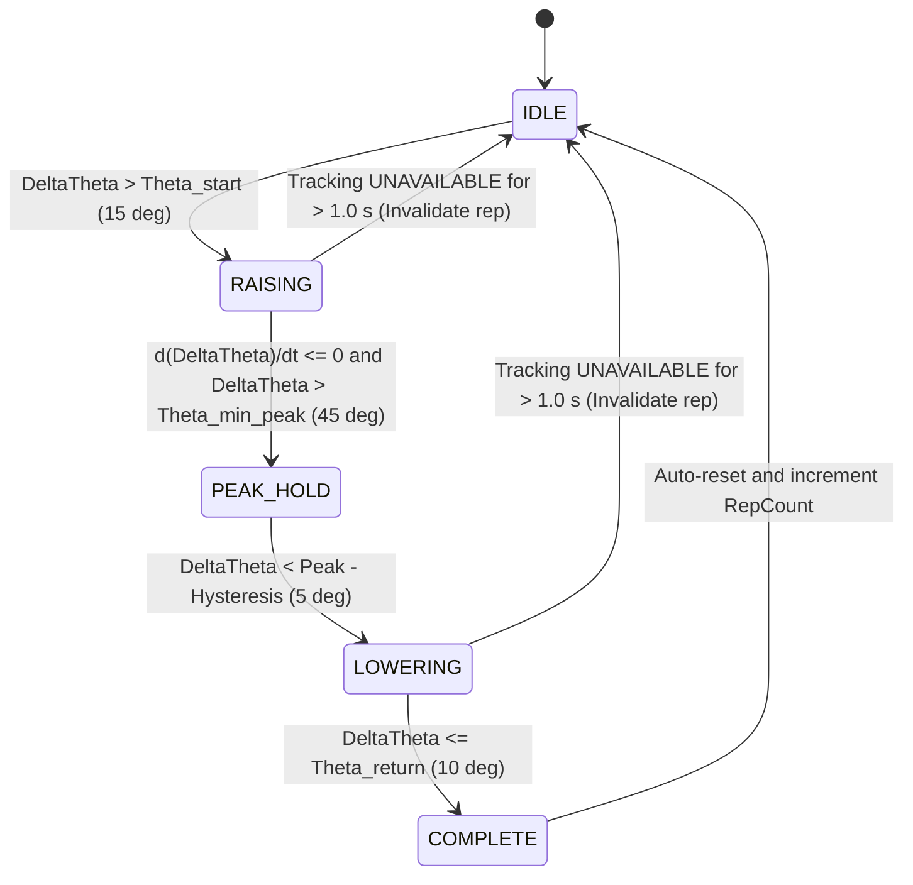

# Mathematical Model: Kinematic Equations, Derivations, and Numerical Safeguards
## AURI: Computer Vision & Biomedical Engine

---

## 1. Vector Primitives and Linear Algebra

### 1.1 Vector Representation
A point or direction vector in Euclidean three-space $\mathbb{R}^3$ is defined as a column vector:
$$\mathbf{p} = \begin{bmatrix} x \\ y \\ z \end{bmatrix} \in \mathbb{R}^3$$

### 1.2 Dot Product (Inner Product)
The dot product between two vectors $\mathbf{a}, \mathbf{b} \in \mathbb{R}^3$ is:
$$\mathbf{a} \cdot \mathbf{b} = a_x b_x + a_y b_y + a_z b_z$$

### 1.3 Cross Product (Vector Product)
The cross product yielding a vector perpendicular to both $\mathbf{a}$ and $\mathbf{b}$ in a right-handed system is:
$$\mathbf{a} \times \mathbf{b} = \begin{bmatrix} a_y b_z - a_z b_y \\ a_z b_x - a_x b_z \\ a_x b_y - a_y b_x \end{bmatrix}$$

### 1.4 Euclidean Norm (Magnitude)
$$\|\mathbf{a}\| = \sqrt{\mathbf{a} \cdot \mathbf{a}} = \sqrt{a_x^2 + a_y^2 + a_z^2}$$

### 1.5 Vector Normalization (Unit Direction)
$$\hat{\mathbf{a}} = \frac{\mathbf{a}}{\|\mathbf{a}\|}$$

### 1.6 Numerical Safeguards for Vectors
1. **Zero-Norm & Small Magnitude Threshold**:
   If $\|\mathbf{a}\| < \epsilon$ where $\epsilon = 10^{-7}$, division by zero occurs. The normalization function must reject the operation and raise a `DegenerateVectorError` or return `None` accompanied by an explicit `QualityStatus.UNAVAILABLE`.
2. **Finite Value Check**:
   Before every operation, all coordinates must be checked:
   $$\operatorname{isfinite}(x) \land \operatorname{isfinite}(y) \land \operatorname{isfinite}(z)$$
   Any NaN or Inf immediately invalidates downstream operations.

---

## 2. Angular Kinematics

### 2.1 Unsigned Angle Between Two Vectors
For two non-zero vectors $\mathbf{a}, \mathbf{b} \in \mathbb{R}^3$:
$$\cos\theta = \frac{\mathbf{a} \cdot \mathbf{b}}{\|\mathbf{a}\| \|\mathbf{b}\|}$$
$$\theta = \arccos\left( \operatorname{clip}\left(\frac{\mathbf{a} \cdot \mathbf{b}}{\|\mathbf{a}\| \|\mathbf{b}\|}, -1.0, 1.0\right) \right)$$
where:
$$\operatorname{clip}(u, -1.0, 1.0) = \max(-1.0, \min(1.0, u))$$
- **Domain**: $\theta \in [0, \pi]$ radians ($[0^\circ, 180^\circ]$).
- **Limitation**: Unsigned; cannot distinguish clockwise from counterclockwise, nor flexion from extension without an anatomical reference plane.

### 2.2 Signed Angle Around a Normal Projection Axis
To determine the signed angle of rotation from $\mathbf{a}$ to $\mathbf{b}$ around a defined unit normal axis $\hat{\mathbf{n}}$ ($\|\hat{\mathbf{n}}\| = 1.0$):
First project $\mathbf{a}$ and $\mathbf{b}$ onto the plane perpendicular to $\hat{\mathbf{n}}$:
$$\mathbf{a}_{\perp} = \mathbf{a} - (\mathbf{a} \cdot \hat{\mathbf{n}})\hat{\mathbf{n}}$$
$$\mathbf{b}_{\perp} = \mathbf{b} - (\mathbf{b} \cdot \hat{\mathbf{n}})\hat{\mathbf{n}}$$
If $\|\mathbf{a}_{\perp}\| < \epsilon$ or $\|\mathbf{b}_{\perp}\| < \epsilon$, the projection is singular (the vector is collinear with the normal axis), and the angle is undefined.
Otherwise, normalize the projected vectors $\hat{\mathbf{a}}_{\perp} = \frac{\mathbf{a}_{\perp}}{\|\mathbf{a}_{\perp}\|}$, $\hat{\mathbf{b}}_{\perp} = \frac{\mathbf{b}_{\perp}}{\|\mathbf{b}_{\perp}\|}$.
The signed angle around $\hat{\mathbf{n}}$ adhering to the right-hand rule is:
$$\theta_{\text{signed}} = \operatorname{atan2}\left( \hat{\mathbf{n}} \cdot (\hat{\mathbf{a}}_{\perp} \times \hat{\mathbf{b}}_{\perp}), \; \hat{\mathbf{a}}_{\perp} \cdot \hat{\mathbf{b}}_{\perp} \right)$$
- **Domain**: $\theta_{\text{signed}} \in [-\pi, \pi]$ radians ($[-180^\circ, +180^\circ]$).

---

## 3. Torso Coordinate Frame Estimation

Let the 3D landmark positions obtained from the pose estimator in world coordinates be:
- $\mathbf{S}_L$: Left Shoulder landmark
- $\mathbf{S}_R$: Right Shoulder landmark
- $\mathbf{H}_L$: Left Hip landmark
- $\mathbf{H}_R$: Right Hip landmark

### 3.1 Torso Center and Landmark Midpoints
Torso shoulder midpoint:
$$\mathbf{S}_c = \frac{\mathbf{S}_L + \mathbf{S}_R}{2}$$
Torso hip midpoint:
$$\mathbf{H}_c = \frac{\mathbf{H}_L + \mathbf{H}_R}{2}$$
Torso coordinate frame origin:
$$\mathbf{o}_T = \mathbf{S}_c$$
*(Alternatively chosen as the sternal notch or mid-torso; $\mathbf{S}_c$ aligns joint center kinematics directly to the shoulder girdle).*

### 3.2 Torso Axis Construction
1. **Superior Axis ($\hat{\mathbf{z}}_T$)**:
   Points upward from hip center to shoulder center along the spinal axis:
   $$\mathbf{z}_0 = \mathbf{S}_c - \mathbf{H}_c$$
   $$\hat{\mathbf{z}}_T = \frac{\mathbf{z}_0}{\|\mathbf{z}_0\|}$$
   *Numerical Guard*: Assert $\|\mathbf{z}_0\| \ge 0.15\,\text{m}$ (rejects collapsed tracking).

2. **Lateral Axis Candidate ($\mathbf{x}_0$)**:
   Points from the subject's left shoulder to the subject's right shoulder (subject's anatomical right):
   $$\mathbf{x}_0 = \mathbf{S}_R - \mathbf{S}_L$$
   *Numerical Guard*: Assert $\|\mathbf{x}_0\| \ge 0.15\,\text{m}$.

3. **Gram-Schmidt Orthogonalization of Lateral Axis ($\hat{\mathbf{x}}_T$)**:
   Remove any component of $\mathbf{x}_0$ parallel to $\hat{\mathbf{z}}_T$:
   $$\mathbf{x}' = \mathbf{x}_0 - (\mathbf{x}_0 \cdot \hat{\mathbf{z}}_T)\hat{\mathbf{z}}_T$$
   $$\hat{\mathbf{x}}_T = \frac{\mathbf{x}'}{\|\mathbf{x}'\|}$$

4. **Anterior Axis ($\hat{\mathbf{y}}_T$)**:
   Points forward (anteriorly) out of the subject's chest, completing a right-handed Cartesian coordinate system:
   $$\hat{\mathbf{y}}_T = \hat{\mathbf{z}}_T \times \hat{\mathbf{x}}_T$$

5. **Handedness and Orthonormality Check**:
   $$\hat{\mathbf{x}}_T \times \hat{\mathbf{y}}_T = \hat{\mathbf{z}}_T$$
   $$\hat{\mathbf{x}}_T \cdot \hat{\mathbf{y}}_T = 0, \quad \hat{\mathbf{y}}_T \cdot \hat{\mathbf{z}}_T = 0, \quad \hat{\mathbf{z}}_T \cdot \hat{\mathbf{x}}_T = 0$$
   $$\|\hat{\mathbf{x}}_T\| = 1, \quad \|\hat{\mathbf{y}}_T\| = 1, \quad \|\hat{\mathbf{z}}_T\| = 1$$

---

## 4. Coordinate Transformations

The rotation matrix $R_{W \leftarrow T}$ transforming coordinates from the Torso Frame $T$ to the World/Source Frame $W$ is formed by the column vectors of the torso axes:
$$R_{W \leftarrow T} = \begin{bmatrix} \hat{\mathbf{x}}_T & \hat{\mathbf{y}}_T & \hat{\mathbf{z}}_T \end{bmatrix} = \begin{bmatrix} x_{T,x} & y_{T,x} & z_{T,x} \\ x_{T,y} & y_{T,y} & z_{T,y} \\ x_{T,z} & y_{T,z} & z_{T,z} \end{bmatrix}$$

Because the axes are strictly orthonormal, the inverse transformation from World to Torso is the matrix transpose:
$$R_{T \leftarrow W} = R_{W \leftarrow T}^T = \begin{bmatrix} \hat{\mathbf{x}}_T^T \\ \hat{\mathbf{y}}_T^T \\ \hat{\mathbf{z}}_T^T \end{bmatrix}$$

### 4.1 Transforming a Point
Given a point $\mathbf{p}_W$ in world coordinates:
$$\mathbf{p}_T = R_{T \leftarrow W} (\mathbf{p}_W - \mathbf{o}_T)$$
Transforming back to world coordinates:
$$\mathbf{p}_W = R_{W \leftarrow T} \mathbf{p}_T + \mathbf{o}_T$$

### 4.2 Transforming a Direction Vector
Direction vectors represent relative orientations and do not experience origin translation:
$$\mathbf{v}_T = R_{T \leftarrow W} \mathbf{v}_W$$
$$\mathbf{v}_W = R_{W \leftarrow T} \mathbf{v}_T$$

### 4.3 Orthonormality and Determinant Validation
Every constructed rotation matrix must satisfy:
$$\| R^T R - I \|_F < 10^{-5}$$
$$\det(R) = +1.0 \pm 10^{-5}$$
where $\| \cdot \|_F$ is the Frobenius norm. If $\det(R) = -1.0$, a reflection occurred (left-handed system), which is invalid and rejected.

---

## 5. Anatomical Segment Direction

Let:
- $\mathbf{S}$: Shoulder landmark of interest (Left or Right)
- $\mathbf{E}$: Elbow landmark
- $\mathbf{W}$: Wrist landmark

### 5.1 Upper-Arm Segment Vector
$$\mathbf{v}_{\text{arm}, W} = \mathbf{E}_W - \mathbf{S}_W$$
$$\hat{\mathbf{v}}_{\text{arm}, W} = \frac{\mathbf{v}_{\text{arm}, W}}{\|\mathbf{v}_{\text{arm}, W}\|}$$
Transform into Torso Frame:
$$\hat{\mathbf{v}}_{\text{arm}, T} = R_{T \leftarrow W} \hat{\mathbf{v}}_{\text{arm}, W}$$

### 5.2 Forearm Segment Vector
$$\mathbf{v}_{\text{forearm}, W} = \mathbf{W}_W - \mathbf{E}_W$$
$$\hat{\mathbf{v}}_{\text{forearm}, W} = \frac{\mathbf{v}_{\text{forearm}, W}}{\|\mathbf{v}_{\text{forearm}, W}\|}$$
$$\hat{\mathbf{v}}_{\text{forearm}, T} = R_{T \leftarrow W} \hat{\mathbf{v}}_{\text{forearm}, W}$$

> [!CRITICAL]
> $\hat{\mathbf{v}}_{\text{arm}, T} \in \mathbb{S}^2$ is a unit direction vector with 2 degrees of freedom. It does **not** specify axial rotation about the longitudinal humeral axis. Treating it as a full $3 \times 3$ rotation matrix without additional constraints is mathematically invalid.

---

## 6. Joint-Angle Calculations

### 6.1 Downward Torso Reference Axis
In the torso coordinate system, the downward neutral reference vector is:
$$\hat{\mathbf{d}}_T = -\hat{\mathbf{z}}_T = \begin{bmatrix} 0 \\ 0 \\ -1 \end{bmatrix}$$

### 6.2 Total Humerothoracic Elevation Angle
The primary elevation angle of the upper arm relative to the torso vertical is:
$$\theta_{\text{elevation}} = \arccos\left( \operatorname{clip}\left(\hat{\mathbf{d}}_T \cdot \hat{\mathbf{v}}_{\text{arm}, T}, -1.0, 1.0\right) \right)$$
- When arm hangs straight down: $\hat{\mathbf{v}}_{\text{arm}, T} = \begin{bmatrix} 0 \\ 0 \\ -1 \end{bmatrix} \implies \hat{\mathbf{d}}_T \cdot \hat{\mathbf{v}}_{\text{arm}, T} = 1.0 \implies \theta_{\text{elevation}} = 0^\circ$.
- When arm is horizontal (any direction): $\hat{\mathbf{v}}_{\text{arm}, T} \cdot \hat{\mathbf{d}}_T = 0 \implies \theta_{\text{elevation}} = 90^\circ$.
- When arm is overhead: $\hat{\mathbf{v}}_{\text{arm}, T} = \begin{bmatrix} 0 \\ 0 \\ 1 \end{bmatrix} \implies \hat{\mathbf{d}}_T \cdot \hat{\mathbf{v}}_{\text{arm}, T} = -1.0 \implies \theta_{\text{elevation}} = 180^\circ$.

### 6.3 Sagittal Flexion Angle
Project $\hat{\mathbf{v}}_{\text{arm}, T}$ onto the sagittal plane ($Y_T - Z_T$ plane):
$$\mathbf{v}_{\text{sag}} = \begin{bmatrix} 0 \\ v_{\text{arm}, y} \\ v_{\text{arm}, z} \end{bmatrix}$$
$$\theta_{\text{flexion}} = \operatorname{atan2}\left( v_{\text{arm}, y}, -v_{\text{arm}, z} \right)$$
- Arm forward: $v_{\text{arm}, y} > 0 \implies \theta_{\text{flexion}} > 0$ (Forward flexion).
- Arm backward: $v_{\text{arm}, y} < 0 \implies \theta_{\text{flexion}} < 0$ (Extension).

### 6.4 Coronal Abduction Angle
Project $\hat{\mathbf{v}}_{\text{arm}, T}$ onto the coronal plane ($X_T - Z_T$ plane):
$$\mathbf{v}_{\text{cor}} = \begin{bmatrix} v_{\text{arm}, x} \\ 0 \\ v_{\text{arm}, z} \end{bmatrix}$$
For the **Right Arm** ($+X_T$ is right, so lateral is $+X_T$):
$$\theta_{\text{abduction, R}} = \operatorname{atan2}\left( v_{\text{arm}, x}, -v_{\text{arm}, z} \right)$$
For the **Left Arm** (lateral is $-X_T$):
$$\theta_{\text{abduction, L}} = \operatorname{atan2}\left( -v_{\text{arm}, x}, -v_{\text{arm}, z} \right)$$
- Arm moved outward: $\theta_{\text{abduction}} > 0$.
- Arm crossed inward over midline (adduction): $\theta_{\text{abduction}} < 0$.

---

## 7. Baseline Calibration and Neutral Zone Engine

### 7.1 Multi-Frame Baseline Estimation
During a calibration phase of $N$ consecutive stable frames (default $N = 30$, ~1 second at 30 FPS):
$$\theta_0 = \operatorname{median}\left(\theta_{\text{raw}}(1), \theta_{\text{raw}}(2), \dots, \theta_{\text{raw}}(N)\right)$$
Calibration quality metric (Interquartile Range):
$$\operatorname{IQR}_0 = Q_3(\theta_{\text{raw}}) - Q_1(\theta_{\text{raw}})$$
*Calibration Acceptance Gate*: If $\operatorname{IQR}_0 > 3.0^\circ$, the subject moved excessively during calibration; reject and prompt for steady posture.

### 7.2 Relative Excursion Calculation
For all subsequent frames $t > N$:
$$\Delta\theta(t) = \theta(t) - \theta_0$$

### 7.3 Neutral Zone Deadband with Hysteresis
Let $\delta_{\text{enter}}$ and $\delta_{\text{exit}}$ be the inner and outer angular thresholds, where:
$$\delta_{\text{enter}} < \delta_{\text{exit}}$$
Default values: $\delta_{\text{enter}} = 3.0^\circ$, $\delta_{\text{exit}} = 5.0^\circ$.

The state of the display engine at frame $t$ is governed by:
$$\operatorname{State}(t) = \begin{cases}
\text{IN\_NEUTRAL}, & \text{if } |\Delta\theta(t)| \le \delta_{\text{enter}} \\
\text{IN\_NEUTRAL}, & \text{if } \operatorname{State}(t-1) = \text{IN\_NEUTRAL} \land |\Delta\theta(t)| < \delta_{\text{exit}} \\
\text{ACTIVE\_EXCURSION}, & \text{if } |\Delta\theta(t)| \ge \delta_{\text{exit}} \\
\text{ACTIVE\_EXCURSION}, & \text{if } \operatorname{State}(t-1) = \text{ACTIVE\_EXCURSION} \land |\Delta\theta(t)| > \delta_{\text{enter}}
\end{cases}$$

The display angle is then computed as:
$$\theta_{\text{display}}(t) = \begin{cases}
0.0^\circ, & \text{if } \operatorname{State}(t) = \text{IN\_NEUTRAL} \\
\Delta\theta(t), & \text{if } \operatorname{State}(t) = \text{ACTIVE\_EXCURSION}
\end{cases}$$

*Data Invariance*: $\theta_{\text{raw}}(t)$, $\theta_{\text{filtered}}(t)$, and $\Delta\theta(t)$ are strictly retained in their raw floating-point form. The deadband function acts strictly on $\theta_{\text{display}}$.

---

## 8. Temporal Filtering

### 8.1 Simple Moving Average (SMA)
For a buffer window of size $W$ (default $W = 5$ frames):
$$\bar{\theta}(t) = \frac{1}{K} \sum_{i=0}^{K-1} \theta(t-i), \quad K = \min(t, W)$$

### 8.2 Exponential Moving Average (EMA)
$$\tilde{\theta}(t) = \alpha \theta(t) + (1 - \alpha) \tilde{\theta}(t-1)$$
where smoothing factor $\alpha \in (0, 1]$ (default $\alpha = 0.4$ for 30 FPS).
- Latency: Group delay $\tau \approx \frac{1 - \alpha}{\alpha} \Delta t \approx 1.5 \times 33\,\text{ms} \approx 50\,\text{ms}$.
- Boundary condition: When tracking transitions from `UNAVAILABLE` to `VALID`, filter is reseeded: $\tilde{\theta}(t) = \theta(t)$.

---

## 9. Repetition Detection State Machine

- $\Theta_{\text{start}} = 15.0^\circ$: Minimum excursion to initiate a repetition.
- $\Theta_{\text{min\_peak}} = 45.0^\circ$: Minimum excursion required to count as a valid repetition attempt.
- $\Theta_{\text{return}} = 10.0^\circ$: Excursion threshold to register completion of lowering phase.

---

## 10. Trunk Compensation Metrics

### 10.1 Lateral Trunk Lean
Angle between the Torso superior axis $\hat{\mathbf{z}}_T$ and the vertical reference $\hat{\mathbf{z}}_{\text{world}} = \begin{bmatrix} 0 \\ 0 \\ 1 \end{bmatrix}$, projected into the coronal plane:
$$\phi_{\text{lean}} = \arcsin\left( \operatorname{clip}\left(\hat{\mathbf{z}}_T \cdot \hat{\mathbf{x}}_W, -1.0, 1.0\right) \right)$$
Threshold: If $|\phi_{\text{lean}}| > 10.0^\circ$, flag `LEAN_DETECTED`.

### 10.2 Shoulder Girdle Hiking
Vertical displacement of the ipsilateral shoulder relative to the torso baseline:
Let $\Delta h_{\text{shoulder}}(t) = (\mathbf{S}(t) - \mathbf{H}_c(t)) \cdot \hat{\mathbf{z}}_T(t)$.
$$H_{\text{hiking}}(t) = \Delta h_{\text{shoulder}}(t) - \Delta h_{\text{shoulder}}(0)$$
Threshold: If $H_{\text{hiking}}(t) > 0.03\,\text{m}$ ($3\,\text{cm}$), flag `HIKING_DETECTED`.

---

## 11. Worked Numerical Examples & Test Vectors

### Example 1: Torso Frame Construction
Given:
- $\mathbf{S}_L = [0.20, 0.0, 1.40]^T$
- $\mathbf{S}_R = [-0.20, 0.0, 1.40]^T$
- $\mathbf{H}_L = [0.15, 0.0, 0.90]^T$
- $\mathbf{H}_R = [-0.15, 0.0, 0.90]^T$

1. Midpoints:
   $\mathbf{S}_c = [0.0, 0.0, 1.40]^T$, $\mathbf{H}_c = [0.0, 0.0, 0.90]^T$.
2. Superior Axis:
   $\mathbf{z}_0 = [0.0, 0.0, 0.50]^T \implies \hat{\mathbf{z}}_T = [0.0, 0.0, 1.0]^T$.
3. Lateral Axis:
   $\mathbf{x}_0 = \mathbf{S}_R - \mathbf{S}_L = [-0.40, 0.0, 0.0]^T$.
   $\mathbf{x}_0 \cdot \hat{\mathbf{z}}_T = 0 \implies \mathbf{x}' = [-0.40, 0.0, 0.0]^T$.
   $\hat{\mathbf{x}}_T = [-1.0, 0.0, 0.0]^T$.
4. Anterior Axis:
   $\hat{\mathbf{y}}_T = \hat{\mathbf{z}}_T \times \hat{\mathbf{x}}_T = [0, 0, 1]^T \times [-1, 0, 0]^T = [0, -1, 0]^T$.
   *(Note: Handedness check: $[-1, 0, 0]^T \times [0, -1, 0]^T = [0, 0, 1]^T = \hat{\mathbf{z}}_T$. Perfectly orthonormal).*

### Example 2: Arm Elevation at 90° Abduction
Right shoulder $\mathbf{S}_R = [-0.20, 0.0, 1.40]^T$, Elbow $\mathbf{E}_R = [-0.50, 0.0, 1.40]^T$.
1. Arm vector:
   $\mathbf{v}_{\text{arm}} = \mathbf{E}_R - \mathbf{S}_R = [-0.30, 0.0, 0.0]^T \implies \hat{\mathbf{v}}_{\text{arm}} = [-1.0, 0.0, 0.0]^T$.
2. In Torso coordinates:
   $\hat{\mathbf{v}}_{\text{arm}, T} = R_{T \leftarrow W} \hat{\mathbf{v}}_{\text{arm}} = \begin{bmatrix} -1 & 0 & 0 \\ 0 & -1 & 0 \\ 0 & 0 & 1 \end{bmatrix} \begin{bmatrix} -1 \\ 0 \\ 0 \end{bmatrix} = \begin{bmatrix} 1 \\ 0 \\ 0 \end{bmatrix}$.
3. Elevation:
   $\hat{\mathbf{d}}_T = [0, 0, -1]^T$.
   $\hat{\mathbf{d}}_T \cdot \hat{\mathbf{v}}_{\text{arm}, T} = 0.0$.
   $\theta_{\text{elevation}} = \arccos(0.0) = \frac{\pi}{2} = 90.0^\circ$. Exact match.

