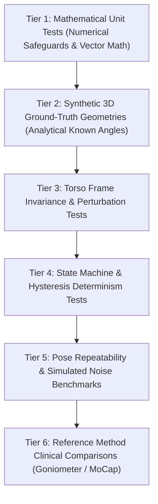

# Validation and Verification Plan
## AURI: Computer Vision & Biomedical Engine

---

## 1. Validation Hierarchy and Philosophy

Verification must proceed strictly from mathematical determinism up to clinical comparative trials:

> [!CRITICAL]
> **Mathematical Verification $\ne$ Clinical Validation**:
> A passing synthetic test proves that our mathematical equations and code execute correctly under specified geometric assumptions. It does **not** prove anatomical ground truth or clinical efficacy.

---

## 2. Verification Tiers

### Tier 1: Mathematical Unit Tests
- **Target**: Pure vector algebra, norms, cross products, dot products, rotation matrices, quaternions.
- **Test Cases**:
  - Orthogonal vector cross products ($\hat{\mathbf{i}} \times \hat{\mathbf{j}} = \hat{\mathbf{k}}$).
  - Anti-parallel vector dot products ($\hat{\mathbf{v}} \cdot (-\hat{\mathbf{v}}) = -1.0$).
  - Zero-vector guard: Verify `ZeroVectorError` or `QualityStatus.UNAVAILABLE` when $\|\mathbf{v}\| < 10^{-7}$.
  - Non-finite guard: Verify rejection when inputs contain `np.nan` or `np.inf`.
  - Orthonormality check: Verify $R^T R = I$ and $\det(R) = +1.0$.

### Tier 2: Synthetic 3D Ground-Truth Geometries
- **Target**: Kinematics solver accuracy on known analytical positions.
- **Test Scenarios**:
  1. **Anatomical Neutral**: Shoulder at origin, elbow at $[0, 0, -0.3]^T$. Expected elevation: $0.0^\circ$.
  2. **Pure Horizontal Abduction (Right Arm)**: Elbow at $[0.3, 0, 0]^T$. Expected elevation: $90.0^\circ$, abduction: $90.0^\circ$, flexion: undefined (`None`; arm has no sagittal component, see ADR-008).
  3. **Pure Overhead Elevation**: Elbow at $[0, 0, 0.3]^T$. Expected elevation: $180.0^\circ$.
  4. **45° Scaption Plane**: Elbow at $[0.3 \cos(45^\circ), 0.3 \sin(45^\circ), 0]^T$. Expected elevation: $90.0^\circ$.
  5. **Left Arm Laterality**: Elbow at $[-0.3, 0, 0]^T$. Expected abduction: $90.0^\circ$.
- **Acceptance Criterion**: Maximum absolute angular error $\le 10^{-5}$ degrees across all analytical cases.

### Tier 3: Torso Frame Invariance & Perturbation
- **Target**: Verify that torso-relative shoulder kinematics remain invariant to global torso translation, yaw, pitch, and roll.
- **Test Procedure**:
  1. Generate synthetic upper body landmarks in standard frontal posture.
  2. Apply global rigid-body translation $\mathbf{t} \in \mathbb{R}^3$ ($\pm 1\,\text{m}$) and rotation $R_{\text{perturb}} \in \text{SO}(3)$ (yaw $\pm 30^\circ$, pitch $\pm 15^\circ$, roll $\pm 20^\circ$).
  3. Calculate arm elevation in Torso Frame before and after perturbation.
- **Acceptance Criterion**: Torso-relative elevation angle must match within $10^{-4}$ degrees of the unperturbed ground truth.

### Tier 4: State Machine & Hysteresis Determinism
- **Target**: Neutral zone deadband and repetition counter state transitions.
- **Test Cases**:
  1. **Zero Excursion Stability**: Input constant baseline angle. Verify display output is strictly $0.0^\circ$.
  2. **Sub-threshold Jitter**: Inject Gaussian noise ($\sigma = 0.8^\circ$, peaks $\le 2.5^\circ$) around baseline. Verify display output remains $0.0^\circ$ for 1000 consecutive frames.
  3. **Hysteresis Exit & Entry**:
     - Ramp angle smoothly from $0^\circ \rightarrow 10^\circ \rightarrow 0^\circ$.
     - Verify display remains $0.0^\circ$ until angle crosses $\delta_{\text{exit}} = 5.0^\circ$.
     - Verify display tracks true angle above $5.0^\circ$.
     - Verify display snaps back to $0.0^\circ$ only when angle drops below $\delta_{\text{enter}} = 3.0^\circ$.
  4. **Tracking Loss Invariance**: Drop landmark confidence to $0.0$. Verify display returns `UNAVAILABLE`, **never** false $0.0^\circ$.

### Tier 5: Pose Repeatability & Simulated Noise Benchmarks
- **Target**: Temporal filter latency and noise rejection.
- **Metrics**:
  - Root Mean Square Error (RMSE) relative to noise-free trajectory.
  - Phase lag / group delay (milliseconds).
  - Landmark dropout recovery time.

### Tier 6: Reference Method Clinical Comparisons (Future)
- **Target**: Empirical validation against clinical reference standards (universal goniometer, digital inclinometer, or optical marker-based Vicon system).
- **Evaluation Metrics**:
  - Mean Absolute Error (MAE): $\frac{1}{M}\sum |\theta_{\text{AURI}} - \theta_{\text{ref}}|$.
  - Root Mean Square Error (RMSE): $\sqrt{\frac{1}{M}\sum (\theta_{\text{AURI}} - \theta_{\text{ref}})^2}$.
  - Bland-Altman Limits of Agreement (mean bias $\pm 1.96\,\text{SD}$).
  - Intraclass Correlation Coefficient (ICC(2,1)).
- **Data Governance**: Zero retention of raw video without institutional IRB approval and patient consent. Numerical kinematic time series only.

